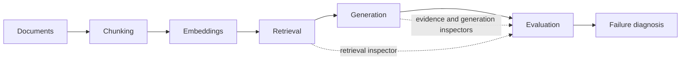
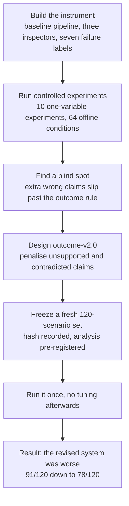
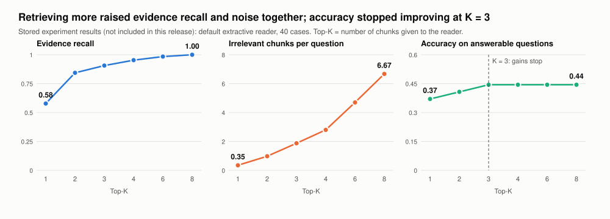
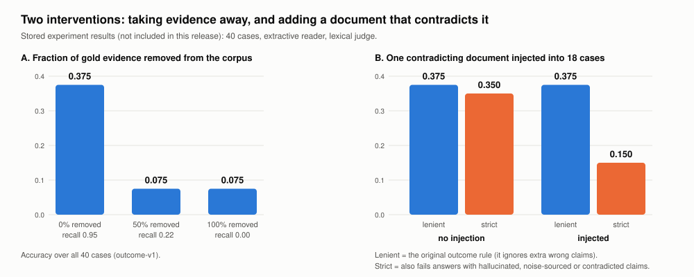
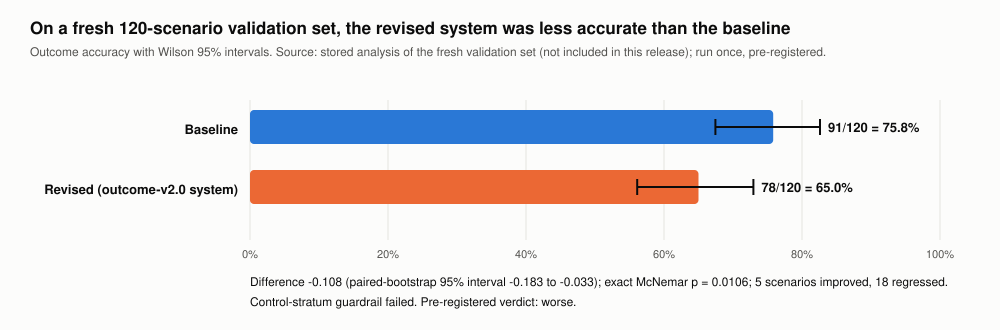
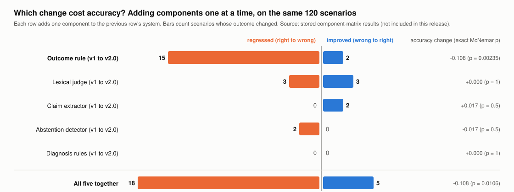

# What happens when a RAG system has the right information but still gives the wrong answer?

A Retrieval-Augmented Generation system can retrieve the relevant documents, put the useful evidence right in front of the language model, and still produce an answer that is wrong or unreliable.

This project is an investigation into why. It builds an **offline evaluation and diagnostic framework** that watches a RAG pipeline at three points (retrieval, evidence, generation), runs controlled experiments on it, and then tests whether its own measuring instrument can be trusted. The last part did not go the way we hoped, and it is the most interesting part of the story.

> **This is an initial research overview, not the runnable framework.** This repository contains the write-up, selected figures and documentation only. The source code, datasets, detailed experiment results and the dashboard described below are **not included** in this release, so nothing here can be run or re-computed from it. Numbers come from stored results held in the private research repository; they are reported, not independently reproducible from this release. A licence has not been chosen yet (see [Licence status](#licence-status)).

> **Scope in one breath.** Everything here ran offline on a small, fictional, AI-authored corpus with a deterministic stand-in reader and a lexical judge. It is a methodology investigation, not a benchmark of real RAG systems. Live Gemini/Groq evaluation is outside the project's scope.

---

## The problem with RAG isn't always retrieval

When a RAG system fails, the first suspect is usually the retriever. But "the answer is wrong" can hide very different stories, and each one needs a different fix:

| Question | What it asks | Typical failure |
|---|---|---|
| **Retrieval quality** | Did the right passages come back? | The evidence never reached the model |
| **Evidence availability** | Was the answer in the corpus at all? | Nothing could have been retrieved |
| **Evidence interpretation** | Did the model read the evidence correctly? | A wrong number, a swapped entity, bad arithmetic |
| **Answer correctness** | Is the final answer right? | Right sources, wrong claim, or a right claim plus an invented one |
| **Evaluation reliability** | Can we trust the tool that scored all of the above? | A judge that cannot verify a correct claim |

The last row is the one most projects skip. Here it turned out to matter most.

## So, how do we investigate this?

The pipeline is conventional. What is different is that every stage is measured separately, so a wrong answer can be traced to where it went wrong.

The study follows a simple loop: build the instrument, use it, find where it is blind, try to fix that, and check the fix on data it has never seen.

## Building the evaluation framework

The baseline pipeline answers 40 questions over seven fictional product documents. Around it sit the pieces that make failures visible. (The implementation is not part of this release; see [`docs/architecture.md`](docs/architecture.md) for the design.)

**Three inspectors** measure what happened. The retrieval inspector checks, by exact text span, whether the gold evidence was actually in the retrieved chunks. The evidence inspector splits the answer into claims and asks, for each, whether the retrieved text supports or contradicts it. The generation inspector adds faithfulness, context utilisation and hallucination measures. Keeping them separate is what lets "the evidence was there" and "the answer used it correctly" be different facts.

**A failure diagnosis** turns those measurements into seven heuristic labels (such as `retrieval_failure`, `context_misinterpretation`, `contradictory_evidence`). Every label lists the measurements that triggered it and keeps the *inferred* cause apart from them, worded as a "likely contributing factor", never a proven cause.

**Controlled experiments** change one variable at a time (chunk size, overlap, embedder, Top-K, reranking, injected noise, removed evidence, an injected contradiction, oracle evidence) and compare conditions case by case with paired statistics.

**Independent validation** checks the diagnosis against scenarios built with a known, designed failure. A separate evaluator-reliability study asks how often the lexical judge is simply wrong.

**An interactive dashboard** shows all of it from saved files only, and calls no model (not included in this release).

## Experiments: what actually happened?

All figures below were generated from the stored experiment results of the research repository (40 cases, extractive reader stand-in, lexical judge). Those result files are not part of this release.

**Full evidence recall was necessary but not sufficient.** Across 16 configurations of the 27 answerable questions (432 question-configuration rows), no answer was correct when evidence recall was below 1 (0 of 48 rows). When recall was 1, only 49% of answers were correct, and every one of the 195 failures was a multi-document or reasoning question. Having the evidence in context did not mean the reader could use it. The reader here is a stand-in that copies sentences and cannot combine facts, so how often this happens with a real language model is unknown, and the rows are not independent.

**More context bought recall at the price of noise, and the benefit ran out early.**

Going from one retrieved chunk to eight raised evidence recall from 0.58 to 1.00, but irrelevant chunks per question grew from 0.35 to 6.7 and context precision fell from 0.81 to 0.21. Accuracy on answerable questions went from 0.37 to 0.44 and stopped improving at K = 3.

**Removing evidence mattered more than anything else we changed.** Taking away half or all of the gold evidence cut accuracy from 0.375 to 0.075. Twelve questions got worse and none got better (exact sign test p = 0.0005). Chunk size, overlap, embedding model and reranking changed between zero and three cases out of 40, indistinguishable from no effect.

**A contradicting document exposed a weakness in our own metric.**

We injected one conflicting sentence into 18 cases (for example, a battery stated as 810 Wh next to the true 540 Wh). The conflicting sentence reached the reader in all 18 cases, and in 13 of the 18 answers it was quoted verbatim right next to the true one. The original outcome rule still scored 0.375, because it only asked whether the answer covered the reference claims and ignored extra wrong claims that retrieved text happened to support. A stricter measure fell from 0.35 to 0.15. The instrument had a blind spot, and that is what motivated a better rule.

## The surprising result: our "improved" evaluator performed worse

The fix was **outcome-v2.0**, a claim-by-claim rule that fails an answer if it contains unsupported or contradicted extra claims. It looked right on the cases that motivated it. So we did what the earlier results did not allow us to do: we froze a brand-new set of 120 scenarios in three new fictional domains (a veterinary clinic, a building-permit office, a data-centre runbook), wrote the analysis plan before running anything, recorded the dataset's hash, ran both versions once, and promised not to tune afterwards.

| System | Correct | Accuracy |
|---|---:|---:|
| Baseline | 91/120 | 75.8% |
| Revised | 78/120 | 65.0% |

The difference was not noise. Of the scenarios whose outcome changed, 5 improved and 18 got worse (exact McNemar p = 0.0106; paired bootstrap 95% interval for the accuracy difference −0.183 to −0.033). A guardrail we registered in advance, that accuracy on ordinary control scenarios must not drop, also failed. Under our own pre-registered rule the verdict is **worse**. **Outcome-v2.0 is an implemented methodology that failed the primary independent validation criterion.** It is not an improvement and not validated.

**Where did the accuracy go?** Adding the five revised components one at a time, on the same scenarios, points at one of them.

The cause, from reading and re-scoring the 18 scenarios that got worse (post hoc, so exploratory, and the manual verdicts are AI annotations, not human ones):

| What went wrong | Scenarios | Example |
|---|---:|---|
| The answer added a claim the documents do not support (the revised rule is meant to fail these; the author's truth had accepted them as harmless) | 5 | a plausible but unsourced aside |
| A correct derived, converted or multi-source claim the judge could not confirm | 5 | "It would cost EUR 72: the EUR 48 fee plus the 50% out-of-hours surcharge" |
| A claim true in the corpus but absent from the gold text it is compared against | 2 | a correct detail the reference never mentioned |
| A correct reference claim the revised lexical judge cannot match at all | 3 | claims made only of numbers and units, such as "every 60 minutes" |
| Other judge and abstention parsing failures | 3 | a polarity mix-up; a refusal sentence scored as a claim |

**The key lesson: a stricter evaluator is not automatically a better evaluator.** Outcome-v2.0 asks the judge to *confirm* every claim in an answer. If the judge cannot verify a perfectly correct claim, the stricter rule punishes the answer for the judge's weakness. The judge here is a lexical overlap heuristic, and it fails on exactly the kind of claim a good answer contains: arithmetic, unit conversions, paraphrase. We found a concrete defect on the way. A claim made only of numbers and units has nothing left to match, so a verbatim copy of the reference answer failed the revised rule in 28 of 84 fresh answerable scenarios, against 0 of 70 on the development set. A likely reason the development set looked fine (accuracy rose from 0.88 to 0.90) while the fresh set did not is that the development answers were much more literal: 13 of 27 correct ones were near-verbatim copies of the reference text, against 2 of 37 on the fresh set. That is a descriptive contrast, not a proven cause.

Two smaller truths belong here too. The revised diagnostic labels looked somewhat better descriptively (exact label-set match 0.458 to 0.550), but not significantly after correcting for multiple tests. And the revised lexical judge's gain on the development set (+5 points) did not replicate on fresh data.

The research repository's read-only dashboard states the verdict plainly, and labels the older development-set figures as development evidence. The dashboard is not included here.

## What we learned

**Retrieval and answer correctness are different things.** Even with perfect evidence recall, only 49% of answers were correct, and every failure was a question that needed more than one fact.

**More retrieved context is not automatically better.** Recall and noise grew together, and the useful part was exhausted at three chunks on this corpus.

**Contradictory evidence needs its own evaluation.** A metric that only asks "did the answer cover the reference?" waves through answers that state the right value and a wrong one.

**Claim extraction and claim verification are separate problems.** A garbled fragment inside one answer turned out to come from fixed-size chunking cutting a word in half, not from the model or the claim extractor. We reported extraction quality on its own and made every dropped claim visible.

**Lexical evaluation has hard limits.** Paraphrase, derived values, unit conversion and negation are exactly where a bag-of-words judge breaks, and a stricter rule built on it inherits every one of those breaks.

**An evaluation framework has to be validated on data it has never seen.** Everything looked good on the cases that shaped it. Only a frozen, pre-registered, run-once test showed that it did not generalise.

## Limitations and research integrity

We would rather you trust the negative result than doubt a positive one, so here is what bounds all of the above.

* **The data are AI-authored.** The corpus, the 40-case dataset and every validation scenario were written by an AI assistant, one author per set, with no human review. Ground truth is constructed, not observed, and correlated blind spots between the author and the rules are likely. The fresh set is independent only in process, not in model family.
* **The judge is a lexical heuristic, and the reader is a stand-in.** There is no language-model judge and no language-model reader. Nothing here says how a real RAG system behaves.
* **The revised outcome rule failed.** It is documented, not fixed. A known defect in the revised lexical judge, and two abstention-handling problems, were left as they are: any change would need a new validation set, because the fresh one is now used up.
* **Samples are small.** 120 scenarios, 40 experiment cases (only 104 and 129 distinct answers across the two readers), per-label results too small to test.
* **Real-world generalisation is unverified,** in either direction.
* **Live Gemini/Groq evaluation is outside the project's scope.** The provider interfaces exist and were only ever exercised against mocks; no stored result used a live model.
* **This release is not reproducible by itself.** The code, data and result files are not included. In the research repository, the tests, the baseline run, the development-set matrix, the statistics and all 64 re-scored experiment conditions were reproduced exactly in a clean copy, and an independent recomputation of the fresh-set statistics agreed. But the exact code state at the time of the single fresh run was never committed, so its recorded code hash cannot be regenerated.
* **Ownership and licensing are not settled.** No licence is stated, and the copyright holder, any institutional terms and a data licence are open decisions for the owner.

The fuller list is in [`docs/limitations.md`](docs/limitations.md).

## What is in this release

| File | What it is |
|---|---|
| [`docs/findings.md`](docs/findings.md) | The research findings in more detail, with the evidence tiers kept apart |
| [`docs/methodology.md`](docs/methodology.md) | The inspectors, the outcome rule, the seven failure labels, the experiments and the validation protocol |
| [`docs/architecture.md`](docs/architecture.md) | The design of the framework, conceptually |
| [`docs/limitations.md`](docs/limitations.md) | What bounds every result |
| [`docs/AI_ASSISTANCE.md`](docs/AI_ASSISTANCE.md) | How AI tools were used |
| [`docs/FICTIONAL_DATA_NOTICE.md`](docs/FICTIONAL_DATA_NOTICE.md) | All data are fictional; veterinary figures are not guidance |

Not included in this release: source code, datasets (original or sanitized), detailed experiment and validation results, the dashboard, tests and working logs.

## AI assistance and data notice

This project was built with substantial help from AI coding assistants, which drafted code, tests, analysis scripts, documentation and figures under the owner's direction. All datasets were also written by AI assistants without human review of the ground truth, and the methodology review, dashboard QA, reproducibility check and licensing review were performed by AI assistants, not human reviewers. Details: [`docs/AI_ASSISTANCE.md`](docs/AI_ASSISTANCE.md).

All companies, products, people and figures in the data are fictional. The veterinary scenarios contain invented dosing figures that are **not** veterinary guidance: see [`docs/FICTIONAL_DATA_NOTICE.md`](docs/FICTIONAL_DATA_NOTICE.md).

## Licence status

**No licence has been chosen for this release, and none is granted by it.** The copyright holder and any institutional terms are still to be confirmed by the project owner, and no licence for the text, figures or any data has been selected. The work builds on published research (RAGChecker and RefChecker for claim-level evaluation and the entailment, contradiction and neutral logic, RAGAS for statement-level faithfulness, ARES for judge-reliability context); no source code from any of them is included.
